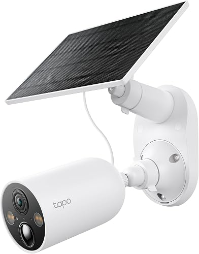
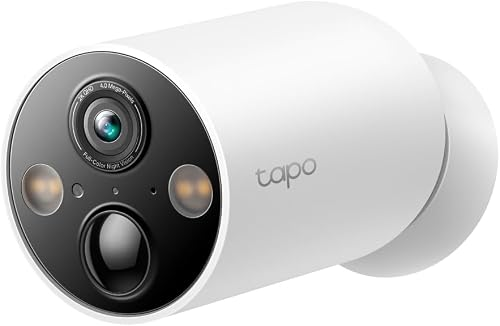
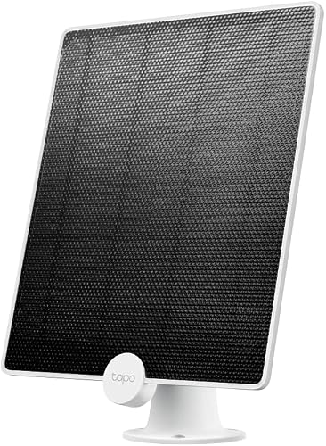
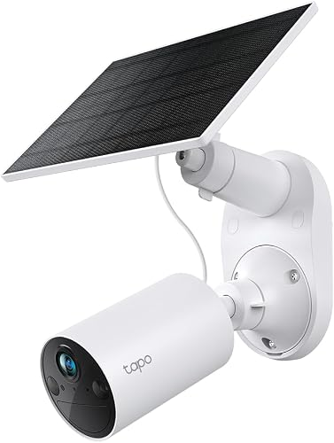
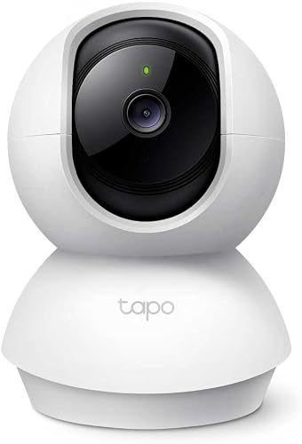

# تقرير كاميرات المراقبة بالطاقة الشمسية للبيت

31 أكتوبر 2026

## الخلاصة

الترشيح: **3 كاميرات Tapo C425 من TP-Link**. اتنين منهم Kit معاهم لوح شمسي للجنينة، والتالتة من غير لوح لباب الشقة. التكلفة **15,795 جنيه للكاميرات**، وحوالي **19,300 جنيه** لو حسبنا 3 كروت ميموري.

- **ليه C425؟** جودة 2K، ورؤية ليلية ملونة، وبطارية كبيرة. وسعر الـ Kit بتاعها بيزيد حوالي 100 جنيه بس عن الموديل الأضعف C410.
- **ليه واي فاي مش 4G؟** الواي فاي واصل لكل الأماكن، فمش محتاجين شريحة ولا باقة نت شهرية.
- **منين؟** الـ Kit من Amazon.eg بـ 5,398 جنيه، والكاميرا لوحدها من نون بـ 4,999 جنيه.

الأسعار دي من المواقع يوم 31 أكتوبر 2026، وممكن تتغير.

## أنواع الكاميرات اللي بتشتغل بالطاقة الشمسية

فيه 3 أنواع. ولأن البيت فيه واي فاي، النوع التاني هو اللي يناسبنا.

| النوع | يناسب مين | ملاحظات |
| --- | --- | --- |
| كاميرا 4G بشريحة + لوح شمسي | أرض أو مزرعة أو موقع شغل، من غير كهربا ولا واي فاي | محتاجة باقة نت شهرية، وبتسجل لما تحس بحركة بس |
| **كاميرا واي فاي ببطارية + لوح شمسي (اختيارنا)** | بيت أو فيلا الواي فاي واصل لمكان الكاميرا فيها | مفيهاش مصاريف شهرية، وبتسجل لما تحس بحركة |
| منظومة كاملة (ألواح + بطارية + كنترولر + جهاز تسجيل NVR) | أكتر من كاميرا محتاجين يسجلوا 24 ساعة | من 25,000 جنيه لفوق تقريباً، ومحتاجة فني يركبها |

## المواصفات المهمة

أهم حاجة في كاميرا البطارية حساس الحركة PIR، لأنه هو اللي بيوفر البطارية. الجدول ده فيه المطلوب واللي بتقدمه C425:

| المواصفة | المطلوب | Tapo C425 |
| --- | --- | --- |
| الجودة | 2K / 4MP، أو 1080p لو الميزانية محدودة | 2K QHD 4MP |
| الاتصال | واي فاي (بيشتغل على 2.4GHz) أو 4G بشريحة | واي فاي |
| حساس الحركة | PIR، ويفرق بين إنسان وحيوان وعربية | موجود |
| البطارية | 10,000 لـ 20,000 mAh | حوالي 10,000 mAh |
| اللوح الشمسي | من 3 لـ 10 وات للكاميرا | 4.5 وات (A200)، ومعاه كابل 4 متر |
| الرؤية الليلية | أشعة تحت حمراء، أو ملونة بكشاف | ملونة |
| مقاومة الجو | IP65 أو IP66، وتستحمل حرارة لحد 60 درجة تقريباً | IP66 |
| التخزين | كارت ميموري أو سحابي (cloud) | كارت لحد 512 جيجا، أو سحابي |
| زاوية الرؤية | واسعة | 150 درجة |
| حاجات إضافية | صوت في الاتجاهين، وإنذار | الاتنين موجودين |

## احتياجات البيت

محتاجين 3 كاميرات واي فاي ببطارية: اتنين معاهم لوح شمسي، وواحدة من غير لوح.

| المكان | العدد | الظروف | الحل |
| --- | --- | --- | --- |
| الجنينة | 2 | فيها شمس وواي فاي | C425 Kit بلوح شمسي، وغالباً مش هتحتاج شحن خالص |
| قدام باب الشقة | 1 | مفيش شمس ولا فيشة كهربا، فيه إضاءة عادية وواي فاي | C425 من غير لوح، تتشحن بكابل USB-C كل شهرين لـ 4 شهور تقريباً |

توحيد الموديل في التلات أماكن معناه تطبيق واحد (Tapo)، وشاحن واحد، وطريقة ضبط واحدة.

**بدائل للباب:**

- **جرس بكاميرا Tapo D230S1:** بيشتغل ببطارية، لو عايز تشوف مين بيرن وتكلمه من الموبايل. سعره في جوميا 5,220 جنيه.
- **سلك USB رفيع من جوه الشقة + Tapo C200 أو C210:** تسجل 24 ساعة من غير شحن. الـ C200 سعرها في أمازون 1,090 جنيه.

## المنتجات المرشحة

التلات منتجات الأولانية هم التشكيلة المرشحة، والاتنين اللي بعدهم بدائل.

### 1. Tapo C425 Kit (كاميرا + لوح شمسي) للجنينة

[صفحة المنتج على Amazon.eg](https://www.amazon.eg/dp/B0D46TG8T6): **5,398 جنيه**. جودتها 2K 4MP، ومعاها رؤية ليلية ملونة، ومقاومة IP66. بتشحن من الشمس باستمرار.

### 2. Tapo C425 لوحدها لباب الشقة

[نون](https://www.noon.com/egypt-ar/search/?q=tapo%20c425): **4,999 جنيه**، وفي [Amazon.eg](https://www.amazon.eg/dp/B0D6FQCHKN) بـ 5,126 جنيه. هي نفس كاميرا الجنينة بس من غير اللوح، وبتتشحن بكابل USB-C كل شهرين لـ 4 شهور.

### 3. لوح شمسي Tapo A200 (لو احتجنا لوح زيادة)

[نون](https://www.noon.com/egypt-ar/search/?q=tapo%20c425): **1,025 جنيه**. قوته 4.5 وات، ومقاومته IP65، ومعاه كابل 4 متر. اللوح ده أصلاً جوه علبة الـ Kit، فمش محتاجين نشتريه لوحده غير لو قررنا نحط لوح لكاميرا الباب بعدين.

### بديل أرخص: Tapo C410 Kit

[صفحة المنتج على Amazon.eg](https://www.amazon.eg/dp/B0DF82Q8JB): **5,299 جنيه**. جودتها وبطاريتها أقل من الـ C425، والفرق في السعر مش مستاهل (حوالي 100 جنيه بس)، فمش منصوح بيها.

### بديل للباب لو عدّينا سلك: Tapo C200

[صفحة المنتج على Amazon.eg](https://www.amazon.eg/dp/B07XLML2YS): **1,090 جنيه**. بتلف 360 درجة وبتسجل 24 ساعة، بس محتاجة كهربا مستمرة، يعني لازم نعدي سلك USB من جوه الشقة.

## مقارنة الأسعار

أرخص سعر لـ C425 Kit كان في أمازون، وأرخص سعر للكاميرا لوحدها كان في نون. الأسعار بالجنيه المصري، واتشافت يوم 31 أكتوبر 2026.

| المنتج | [Amazon.eg](https://www.amazon.eg/s?k=Tapo+C425) | [نون](https://www.noon.com/egypt-ar/search/?q=tapo%20c425) | [جوميا](https://www.jumia.com.eg/ar/catalog/?q=tapo) |
| --- | --- | --- | --- |
| C425 Kit (كاميرا + لوح) | **5,398** (فاضل منه 2 بس) | 9,349 | مش موجود |
| C425 لوحدها | 5,126 | **4,999** | مش موجود |
| لوح شمسي A200 لوحده | حوالي 890 (ماركة تانية متوافقة) | 1,025 | مش موجود |
| C410 Kit | 5,299 | مش موجود | 4,620 (من غير لوح) |
| جرس الباب D230S1 | مش متشاف | مش متشاف | 5,220 |
| C200 (محتاجة فيشة) | 1,090 | مش متشاف | 1,262 |
| كارت SanDisk مقاس 64 جيجا | 1,175 | مش متشاف | مش متشاف |
| كارت SanDisk مقاس 128 جيجا | 1,890 – 2,273 | مش متشاف | مش متشاف |

الـ C410 Kit أرخص بـ 100 جنيه بس من الـ C425 Kit، مع إن جودته أقل وبطاريته أصغر. علشان كده الـ C425 هي الاختيار الأحسن.

## التشكيلة النهائية والتكلفة

الإجمالي حوالي **19,320 جنيه**، وده شامل التلات كاميرات والتلات كروت.

| القطعة | العدد | منين | سعر القطعة (جنيه) | الإجمالي (جنيه) |
| --- | --- | --- | --- | --- |
| Tapo C425 Kit (كاميرا + لوح) للجنينة | 2 | Amazon.eg | 5,398 | 10,796 |
| Tapo C425 لوحدها للباب | 1 | نون | 4,999 | 4,999 |
| كارت SanDisk مقاس 64 جيجا | 3 | Amazon.eg | 1,175 | 3,525 |
| **الإجمالي** | | | | **19,320** |

- **ليه 64 جيجا مش 128؟** الكاميرات دي بتسجل مقاطع قصيرة لما يحصل حركة بس، مش تسجيل متواصل، فالـ 64 جيجا كفاية جداً.
- **لو عايز تشتري من مكان واحد:** خد التلاتة C425 Kit من أمازون بـ 16,194 جنيه، يعني أغلى بحوالي 400 جنيه بس، ويفضل معاك لوح شمسي زيادة. بس خلي بالك إن المعروض كان قطعتين بس.
- **خصم إضافي:** أمازون عامل خصم 20% لكروت NBE Visa Signature.

## نصايح الشراء والتركيب

**قبل الشراء**

- اختبر الواي فاي في مكان كل كاميرا بالظبط: افتح فيديو على الموبايل وانت واقف هناك. الكاميرات دي بتشتغل على 2.4GHz بس، ولو الإشارة ضعيفة هتحتاج مقوي (Extender).
- اتأكد إن الحامل (Mount) جوه العلبة، وإن سلك اللوح الشمسي طويل كفاية يوصل لمكان الشمس. سلك الـ A200 طوله 4 متر.
- اشتري من البايع الرسمي أو اللي بيدي ضمان، وابعد عن صفحات فيسبوك اللي مفيهاش معاينة أو دفع عند الاستلام.

**التركيب**

- علّي الكاميرا حوالي 2.5 لـ 3 متر علشان محدش يطولها.
- وجّه اللوح الشمسي ناحية الجنوب، وميّله حوالي 30 درجة، في مكان مفيهوش ضل شجر.
- لو تقدر، خلي الكاميرا في الضل واللوح بس هو اللي في الشمس، علشان البطارية متسخنش في الصيف.
- امسح التراب من على اللوح كل كام أسبوع، لأن التراب بيقلل الشحن جامد.
- قدام الباب: وجّه الكاميرا على بابك والسلم، مش على باب الجيران.

**الضبط وإطالة عمر البطارية**

- غيّر الباسورد الافتراضي أول ما تركب، وضيف التلات كاميرات على حساب واحد في تطبيق Tapo.
- حدد منطقة الحركة (Activity Zone)، وخلي الإشعارات والتسجيل للأشخاص بس.
- قلل مدة الكليب لحوالي 15 – 20 ثانية.
- متفتحش البث المباشر كتير، لأنه أكتر حاجة بتسحب بطارية. ده مهم خصوصاً لكاميرا الباب اللي ملهاش لوح.

## المصادر

- [Amazon.eg: بحث Tapo C425](https://www.amazon.eg/s?k=Tapo+C425&language=ar_AE)
- [Amazon.eg: بحث لوح Tapo A200](https://www.amazon.eg/s?k=Tapo+A200+solar+panel&language=ar_AE)
- [Amazon.eg: بحث كروت SanDisk](https://www.amazon.eg/s?k=sandisk+ultra+microsd+128gb&language=ar_AE)
- [نون: بحث Tapo C425](https://www.noon.com/egypt-ar/search/?q=tapo%20c425)
- [جوميا: بحث Tapo](https://www.jumia.com.eg/ar/catalog/?q=tapo)

صور المنتجات من صفحات المنتجات على Amazon.eg.

